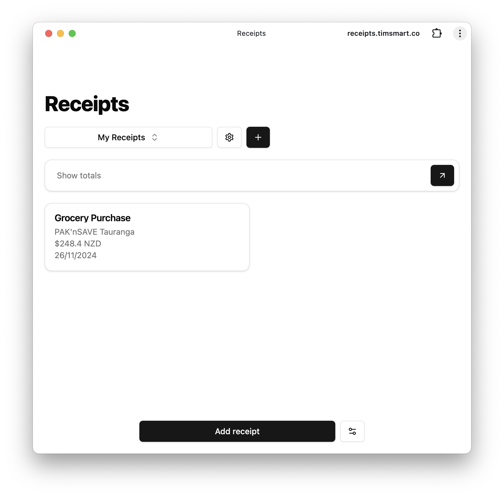

# Receipt scanner + tracker

A simple local-first receipt scanner and tracker.

## Features

- Use OpenAI's GPT-4o to extract information from receipt images.
- Store receipt information in a local SQLite database.
- Supports syncing with a remote server, to share receipts across devices.
- Supports offline mode, with automatic sync when the server is available.
- Install as a PWA on your phone or desktop.

## Installation

1. The client is hosted on Vercel at https://receipts.timsmart.co
2. You can run a remote sync server using Docker: https://hub.docker.com/r/timsmart/effect-eventlog-sqlite

   - `docker run -d -p 3000:3000 -v /path/to/data:/data timsmart/effect-eventlog-sqlite`

3. Set the remote server URL in the client settings.

## Upgrading synced devices

Receipts, groups and images sync as `EventRow` events (`Receipt`, `ReceiptGroup`, `Image`). Older releases wrote separate create / update / delete events instead. The current release still reads those older events, from local journals and from the remote.

Older and newer events for the same receipt never conflict with each other in the journal. So when an older event arrives after a newer edit, for example from a device that upgraded with edits it hadn't synced yet, the app doesn't apply it on its own. It rebuilds the receipts, groups and images tables from the whole journal in event order, which gives every device the same result. It also rebuilds once on the first start after upgrading, which picks up any new events an older release received but skipped.

Older releases ignore the new events without an error, so a device still on an older release won't show receipts, groups or images created or edited on upgraded devices. Its own edits still sync. Upgrade every device that syncs with the same remote. Nothing is lost while one lags behind; it catches up when it upgrades.

Backups are unaffected. The backup file format hasn't changed, so backups import into either version.
